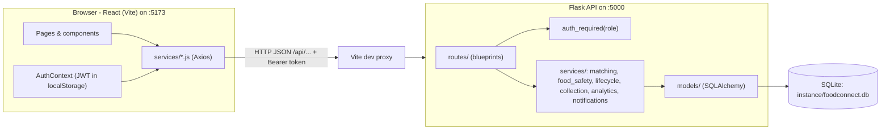
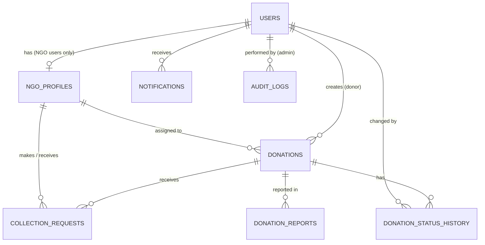
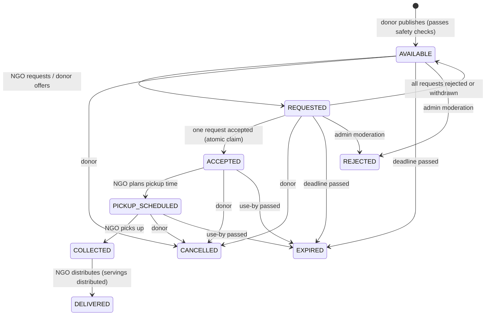

# FoodConnect — An AI-Enabled Food Waste Reduction Platform

> **"Turn surplus food into shared hope."**

FoodConnect connects people and organisations with **surplus food** (restaurants, hotels, college canteens, bakeries, supermarkets, caterers, households) to **verified NGOs** that distribute it to people in need. It uses an **explainable matching algorithm**, **time-based food safety checks**, a **validated donation lifecycle** and **near-real-time status tracking**.

End-semester engineering project · React + Flask + SQLite · built so that three beginners can run, understand and explain every part.

---

## Table of contents
1. [Project overview](#1-project-overview)
2. [Problem statement](#2-problem-statement)
3. [Existing system limitations](#3-existing-system-limitations)
4. [Proposed solution](#4-proposed-solution)
5. [Main objectives](#5-main-objectives)
6. [Functional requirements](#6-functional-requirements)
7. [Non-functional requirements](#7-non-functional-requirements)
8. [Architecture overview](#8-architecture-overview)
9. [Technology stack](#9-technology-stack-and-why-each-was-chosen)
10. [Database schema and relationships](#10-database-schema-and-relationships)
11. [Folder structure](#11-folder-structure)
12. [Windows setup (step by step)](#12-complete-windows-setup-instructions)
13. [Install dependencies](#13-commands-to-install-dependencies)
14. [Initialise and seed the database](#14-commands-to-initialise-and-seed-the-database)
15. [Run the backend and frontend](#15-commands-to-run-the-backend-and-frontend)
16. [Demo login credentials](#16-demo-login-credentials)
17. [API endpoint documentation](#17-api-endpoint-documentation)
18. [Matching algorithm + worked example](#18-the-matching-algorithm-with-a-worked-numerical-example)
19. [Donation lifecycle](#19-donation-lifecycle)
20. [Food safety validation](#20-food-safety-validation)
21. [Testing](#21-testing-instructions)
22. [Known limitations and future enhancements](#22-known-limitations-and-future-enhancements)
23. [Common errors and fixes](#23-common-errors-and-how-to-fix-them)

More detailed, beginner-friendly explanations are in the [`docs/`](docs) folder:
[Project](docs/PROJECT_EXPLANATION.md) · [Database](docs/DATABASE_EXPLANATION.md) · [API](docs/API_EXPLANATION.md) · [Matching](docs/MATCHING_ALGORITHM.md) · [Demo script](docs/DEMO_SCRIPT.md) · [Viva questions](docs/VIVA_QUESTIONS.md) · [Team division](docs/TEAM_DIVISION.md)

---

## 1. Project overview

| Role | What they can do |
|---|---|
| **Food donor** | Register, list surplus food, see the safety checklist, see ranked NGO recommendations with score breakdowns, offer food to an NGO or accept NGO requests, track the donation, cancel it, view history and impact. |
| **NGO** | Register (starts *pending*), maintain service areas/capacity/preferences, see recommended donations, browse and filter all open donations, request donations or accept donor offers, update pickup → collected → delivered, view servings received and distributed. |
| **Administrator** | Verify or reject NGOs, suspend/reactivate accounts, inspect all donations and requests, remove unsafe donations, resolve reports, read contact messages, view analytics and the audit log. |

## 2. Problem statement

Large amounts of edible food are thrown away every day by food businesses and events, while shelters and community kitchens nearby lack food. Surplus food is perishable, so it must reach an organisation that **serves that area, has space, accepts that kind of food, can store it correctly and can arrive before it spoils**. Today this matching is done by phone calls and messaging groups.

## 3. Existing system limitations

- Manual coordination (calls, WhatsApp groups) does not scale and depends on who happens to answer.
- Nobody checks that the receiving NGO can store the food (e.g. refrigerated) or collect it before it expires.
- No shared record of who requested, who collected and when → duplicate trips or missed pickups.
- Two NGOs may both think they are collecting the same food.
- Donors cannot see the outcome or impact of their donations.
- No accountability: no verification of NGOs and no moderation of fake or unsafe listings.

## 4. Proposed solution

A web platform where:
1. Donors list food with preparation time, use-by time and pickup deadline. **The backend blocks expired or time-impossible donations** and records warnings for risky ones.
2. An **explainable weighted-scoring algorithm** ranks only **verified** NGOs that pass hard safety/capacity/timing filters, and explains every point in plain English.
3. NGOs request donations (or accept donor offers). **An atomic database update guarantees only one NGO can claim a donation.**
4. The donation follows a **validated lifecycle** (AVAILABLE → … → DELIVERED). Every change is stored in a history table and generates **in-app notifications**.
5. Dashboards show statistics **calculated from the database**, with clearly separated illustrative estimates.

## 5. Main objectives

1. Reduce edible food waste by making surplus food easy to list and quick to match.
2. Match food to the *right* NGO using transparent, explainable criteria.
3. Never let a matching score override food-safety or capacity rules.
4. Give donors, NGOs and admins one shared, trustworthy record of every donation.
5. Keep the system simple enough for beginners to build, run and explain.

## 6. Functional requirements

| # | Requirement | Where it is implemented |
|---|---|---|
| FR1 | Registration / login / logout with roles donor, NGO, admin | `backend/app/routes/auth_routes.py` |
| FR2 | Role-based access on every sensitive endpoint | `backend/app/utils/auth_helpers.py` (`auth_required`) |
| FR3 | Donors create, edit (while untouched), cancel and track donations | `backend/app/routes/donation_routes.py` |
| FR4 | Food-safety validation and checklist | `backend/app/services/food_safety.py` |
| FR5 | Explainable NGO ranking (score 0–100 + reasons) | `backend/app/services/matching.py` |
| FR6 | NGO requests / donor offers / accept / reject / withdraw | `backend/app/services/collection_service.py` |
| FR7 | Prevent two NGOs claiming the same donation | `accept_collection_request()` (atomic conditional UPDATE) |
| FR8 | Validated status lifecycle with history | `backend/app/services/lifecycle.py` |
| FR9 | In-app notifications from real events | `backend/app/services/notification_service.py` |
| FR10 | NGO verification, user suspension, moderation, reports, audit log | `backend/app/routes/admin_routes.py` |
| FR11 | Analytics from database records | `backend/app/services/analytics.py` |
| FR12 | Responsive React UI for all three roles | `frontend/src/pages/**` |

## 7. Non-functional requirements

- **Security:** hashed passwords (Werkzeug), signed JWTs, logout token blocklist, role + ownership checks on the server, no secrets in code (`.env`), exact addresses hidden from NGOs until accepted.
- **Reliability:** backend validation on every input, consistent JSON errors, transactions for multi-row changes, atomic claim, 54 automated tests.
- **Usability:** clean green/white design, loading states, empty states, confirmation dialogs, accessible labels, keyboard support (Escape closes dialogs), mobile layout.
- **Maintainability:** small modules with one job each, beginner-friendly names and comments, SQLAlchemy models portable to PostgreSQL.
- **Performance:** indexes on status/deadline/foreign keys, paginated lists, polling every 15–30 s instead of constant requests.
- **Honesty:** no fake AI scores, no GPS claims, food-safety disclaimer, estimates labelled as estimates.

## 8. Architecture overview



**Request → response in one sentence:** a React page calls a function in `src/services`, Axios adds the JWT and sends JSON to `/api/...`, Vite forwards it to Flask, the route checks the token and role, a service applies the business rules, SQLAlchemy reads/writes SQLite, and Flask returns `{success, message, data}` which the page displays.

## 9. Technology stack and why each was chosen

| Layer | Technology | Why |
|---|---|---|
| UI | **React 18 + Vite** | Component-based UI; Vite starts in seconds and proxies API calls. |
| Language | **JavaScript** (no TypeScript) | Lower learning curve for beginners. |
| Styling | **Tailwind CSS 3** | Consistent spacing/colours with utility classes; shared recipes in `src/index.css`. |
| Routing | **React Router 6** | Separate URLs per page, protected route wrapper. |
| HTTP | **Axios** | Interceptors add the token and handle expired sessions in one place. |
| Charts | **Recharts** | Simple React chart components for monthly trends and categories. |
| Icons | **Lucide React** | Clean, consistent open-source icons. |
| API | **Flask 3** + Blueprints | Minimal, readable Python web framework; one file per feature area. |
| ORM | **Flask-SQLAlchemy / SQLAlchemy 2** | Python classes instead of raw SQL; switch to PostgreSQL by changing `DATABASE_URL`. |
| Auth | **Flask-JWT-Extended** + Werkzeug hashing | Standard token login; never store plain passwords. |
| CORS | **Flask-CORS** | Allows the configured frontend origins only. |
| DB | **SQLite** | Zero installation, single file, perfect for demos. |
| Tests | **pytest** | Simple, readable tests with an in-memory database. |
| Matching | **Plain Python weighted scoring** | Deterministic, explainable, free, no API keys. |

## 10. Database schema and relationships



| Model (table) | Purpose |
|---|---|
| `User` (`users`) | Every account. Stores name, unique email, **password hash**, role, contact/area, suspension flag. |
| `NGOProfile` (`ngo_profiles`) | One per NGO user (one-to-one). Service areas, postal codes, capacity, travel time, preferred categories, dietary rule, storage abilities, **verification status**. |
| `Donation` (`donations`) | One surplus-food listing. Food details, quantity **and** servings (stored separately), times, pickup location, **status**, assigned NGO, safety warnings. |
| `CollectionRequest` (`collection_requests`) | Links a donation and an NGO. `initiated_by` = `ngo` (NGO asks) or `donor` (donor offers). Unique per (donation, NGO). |
| `DonationStatusHistory` | Append-only log of every status change: old, new, when, who, note. Powers the timeline. |
| `Notification` | In-app messages created by backend events. |
| `AuditLog` | Admin actions (verify NGO, suspend user, remove donation, resolve report). |
| `DonationReport` | A user flags a donation; admin resolves or dismisses. |
| `ContactMessage` | Messages from the public contact page. |
| `TokenBlocklist` | IDs of logged-out JWTs so they cannot be reused. |

Constraints and indexes: unique email, unique `ngo_profiles.user_id`, unique `(donation_id, ngo_id)` request, `CHECK servings > 0`, `CHECK quantity > 0`, role/verification CHECKs, indexes on status, deadline, foreign keys and timestamps. Foreign keys are enforced in SQLite (`PRAGMA foreign_keys=ON`). Full explanation: [docs/DATABASE_EXPLANATION.md](docs/DATABASE_EXPLANATION.md).

## 11. Folder structure

```
FoodConnect (this folder)
├── README.md
├── .gitignore
├── backend/                      ← Member 2 (+ Member 3 for services/ and tests/)
│   ├── run.py                    start the API server
│   ├── config.py                 settings, reads .env
│   ├── seed.py                   demo data (safe to re-run)
│   ├── requirements.txt
│   ├── .env.example              copy to .env
│   ├── instance/                 SQLite database file lives here
│   ├── app/
│   │   ├── __init__.py           create_app(): wires everything together
│   │   ├── extensions.py         db and jwt objects
│   │   ├── models/               database tables (User, Donation, ...)
│   │   ├── routes/               API endpoints (one blueprint per area)
│   │   ├── services/             business rules
│   │   │   ├── matching.py           ★ explainable matching (Member 3)
│   │   │   ├── food_safety.py        ★ safety & expiry checks (Member 3)
│   │   │   ├── lifecycle.py          ★ status transitions (Member 3)
│   │   │   ├── analytics.py          ★ dashboard numbers (Member 3)
│   │   │   ├── collection_service.py requests + atomic claim (Member 2)
│   │   │   └── notification_service.py notifications + audit (Member 2)
│   │   └── utils/                validators, responses, auth decorator, constants, time
│   └── tests/                    pytest tests
├── frontend/                     ← Member 1
│   ├── package.json, vite.config.js, tailwind.config.js, .env.example
│   └── src/
│       ├── main.jsx, App.jsx     entry point and all routes
│       ├── context/AuthContext.jsx   who is logged in
│       ├── services/             one file per API area (Axios)
│       ├── hooks/                useAuth, useApi (loading + polling), useToast
│       ├── layouts/              PublicLayout, DashboardLayout (sidebar)
│       ├── components/           reusable UI (cards, badges, timeline, match card...)
│       ├── pages/public|donor|ngo|admin|shared
│       └── utils/                labels, date formatting, form validation
└── docs/                         explanations, demo script, viva questions, team division
```

## 12. Complete Windows setup instructions

**Install once:**
1. **Python 3.11+** from <https://www.python.org/downloads/> — tick **"Add python.exe to PATH"** during installation.
2. **Node.js 18+ (LTS)** from <https://nodejs.org/>.
3. Open **Command Prompt** or **PowerShell** and check:
   ```bash
   python --version
   node --version
   npm --version
   ```

**Get the project:** copy/unzip the project folder, then open a terminal *inside* it (in File Explorer, type `cmd` in the address bar and press Enter).

> Folder paths with spaces (e.g. `7th sem`) are fine — always wrap them in quotes when using `cd`.

## 13. Commands to install dependencies

**Backend** (terminal 1):
```bash
cd backend
python -m venv venv
venv\Scripts\activate
pip install -r requirements.txt
copy .env.example .env
```
(PowerShell: if activation is blocked, run `Set-ExecutionPolicy -Scope CurrentUser RemoteSigned` once, or use `venv\Scripts\activate.bat` from Command Prompt.)

**Frontend** (terminal 2):
```bash
cd frontend
npm install
```

## 14. Commands to initialise and seed the database

With the backend virtual environment active:
```bash
python seed.py
```
This **creates all tables** in `backend/instance/foodconnect.db` and inserts demo data (1 admin, 5 donors, 5 NGOs — one pending verification — 17 donations in every status, requests, history, notifications, reports, audit entries). **It deletes existing data each time**, so you can re-run it before every demo to get fresh times. It refuses to run when `APP_ENV=production`.

The tables are also created automatically when the server starts (empty database).

## 15. Commands to run the backend and frontend

Terminal 1 — backend (venv active, inside `backend`):
```bash
python run.py
```
→ API on <http://127.0.0.1:5000/api> (health check: <http://127.0.0.1:5000/api/health>)

Terminal 2 — frontend (inside `frontend`):
```bash
npm run dev
```
→ open <http://localhost:5173>

Both must run at the same time. The frontend calls `/api/...`; Vite forwards those calls to Flask (see `frontend/vite.config.js`).

## 16. Demo login credentials

Passwords come from `backend/.env` (`DEMO_ADMIN_PASSWORD`, `DEMO_USER_PASSWORD`). With the default `.env.example` values:

| Role | Email | Password |
|---|---|---|
| Admin | `admin@foodconnect.demo` | `DemoAdmin@2026` |
| Donor (restaurant) | `restaurant@foodconnect.demo` | `DemoUser@2026` |
| Donor (others) | `hotel@`, `canteen@`, `bakery@`, `priya@foodconnect.demo` | `DemoUser@2026` |
| NGO (verified) | `helpinghands@foodconnect.demo` | `DemoUser@2026` |
| NGO (verified) | `annadhanam@`, `greenplate@`, `annanagar@foodconnect.demo` | `DemoUser@2026` |
| NGO (pending) | `littlelights@foodconnect.demo` | `DemoUser@2026` |

> ⚠️ **These are local demo credentials only.** The `.demo` domain is not real. To change them, edit `DEMO_ADMIN_EMAIL`, `DEMO_ADMIN_PASSWORD` and `DEMO_USER_PASSWORD` in `backend/.env` and run `python seed.py` again. Also replace `SECRET_KEY` and `JWT_SECRET_KEY` (generate with `python -c "import secrets; print(secrets.token_hex(32))"`). Admin accounts cannot be self-registered; they are only created by the seed script.

**Creating your own demo accounts:** use *Get started* on the website (donor or NGO). A new NGO must be verified by the admin (*Admin → NGO verification*) before it can request donations.

## 17. API endpoint documentation

All responses use one format:
```json
{ "success": true,  "message": "Donation published.", "data": { ... } }
{ "success": false, "error": { "code": "VALIDATION_ERROR", "message": "Please fix the highlighted fields.", "details": { "servings": "Must be at least 1." } } }
```
Status codes: `200` OK, `201` created, `400` validation, `401` not logged in / bad token, `403` wrong role/suspended/not owner, `404` not found, `409` conflict (invalid transition, already claimed, duplicate), `422` safety/eligibility rule failed, `500` server error.

Auth column: **Public**, **Any** (logged in), or the required role. Send the token as `Authorization: Bearer <token>`.

| Method | URL | Auth | Purpose |
|---|---|---|---|
| GET | `/api/health` | Public | Server check |
| GET | `/api/public/stats` | Public | Landing page statistics |
| POST | `/api/public/contact` | Public | Send contact message |
| POST | `/api/auth/register` | Public | Register donor or NGO |
| POST | `/api/auth/login` | Public | Log in → token |
| POST | `/api/auth/logout` | Any | Revoke current token |
| GET | `/api/auth/me` | Any | Current user (+ NGO profile) |
| GET/PUT | `/api/profile` | Any | View / update own account |
| PUT | `/api/profile/password` | Any | Change password |
| GET/PUT | `/api/ngo/profile` | NGO | View / update organisation & capacity |
| GET | `/api/ngo/dashboard` | NGO | NGO statistics |
| POST | `/api/donations/safety-check` | Donor | Preview safety rules (no save) |
| POST | `/api/donations` | Donor | Create donation |
| GET | `/api/donations/mine` | Donor | Own donations (`scope`, `status`, `search`, `page`) |
| PUT | `/api/donations/<id>` | Donor (owner) | Edit an untouched AVAILABLE donation |
| POST | `/api/donations/<id>/cancel` | Donor (owner) | Cancel |
| GET | `/api/donations/<id>/matches` | Donor (owner), Admin | Ranked NGOs with score breakdown |
| POST | `/api/donations/<id>/offer` | Donor (owner) | Offer donation to an NGO |
| GET | `/api/donations/available` | NGO | Open donations with filters |
| GET | `/api/donations/recommended` | NGO | Open donations ranked for this NGO |
| GET | `/api/donations/collections` | NGO | Assigned donations (`scope=active|completed`) |
| POST | `/api/donations/<id>/requests` | NGO (verified) | Request a donation |
| POST | `/api/donations/<id>/status` | NGO (assigned) | PICKUP_SCHEDULED / COLLECTED / DELIVERED |
| GET | `/api/donations/<id>` | Any (with access) | Details, history, requests, checklist, allowed actions |
| POST | `/api/donations/<id>/report` | Donor/NGO | Report a donation |
| GET | `/api/requests/incoming` | Donor/NGO | Requests waiting for my decision |
| GET | `/api/requests/sent` | Donor/NGO | Requests I created |
| POST | `/api/requests/<id>/accept` | Receiving party | Accept (atomic claim) |
| POST | `/api/requests/<id>/reject` | Receiving party | Reject |
| POST | `/api/requests/<id>/withdraw` | Creator | Withdraw pending request |
| GET | `/api/notifications` | Any | My notifications (`unread=true`) |
| GET | `/api/notifications/unread-count` | Any | Bell badge |
| POST | `/api/notifications/<id>/read`, `/read-all` | Any | Mark read |
| GET | `/api/analytics/donor` · `/ngo` · `/admin` | Role | Dashboard statistics |
| GET | `/api/admin/dashboard` | Admin | Overview + recent activity |
| GET | `/api/admin/users` | Admin | Users (`role`, `status`, `search`) |
| POST | `/api/admin/users/<id>/suspend` · `/reactivate` | Admin | Suspend (reason required) / reactivate |
| GET | `/api/admin/ngos` | Admin | NGOs by verification status |
| POST | `/api/admin/ngos/<id>/verify` · `/reject` | Admin | Verify / reject NGO |
| GET | `/api/admin/donations` · `/requests` | Admin | All donations / requests |
| POST | `/api/admin/donations/<id>/reject` | Admin | Remove donation (→ REJECTED) |
| GET | `/api/admin/reports` · `/contact-messages` · `/audit-logs` | Admin | Moderation & audit |
| POST | `/api/admin/reports/<id>/resolve` | Admin | Resolve/dismiss (optionally remove donation) |

**Example — create a donation**
```http
POST /api/donations
Authorization: Bearer eyJhbGciOi...
Content-Type: application/json

{ "food_name": "Veg biryani", "category": "cooked_meals", "quantity": 10, "quantity_unit": "kg",
  "servings": 40, "dietary_type": "vegetarian", "is_packaged": false, "storage_type": "room_temperature",
  "allergens": "nuts", "prepared_at": "2026-10-15T09:00:00Z", "expires_at": "2026-10-15T15:00:00Z",
  "pickup_deadline": "2026-10-15T13:00:00Z", "pickup_address": "12 LB Road", "pickup_area": "Adyar",
  "pickup_postal_code": "600020", "safety_declaration": true }
```
```json
201 Created
{ "success": true, "message": "Donation published. See the recommended NGOs below.",
  "data": { "donation": { "id": 18, "status": "AVAILABLE", "...": "..." },
            "safety": { "errors": {}, "warnings": ["Unpackaged cooked food: keep it covered ..."], "is_publishable": true } } }
```
More examples for every endpoint: [docs/API_EXPLANATION.md](docs/API_EXPLANATION.md).

## 18. The matching algorithm (with a worked numerical example)

File: `backend/app/services/matching.py`. Two stages:

**Stage 1 – hard filters (NGO excluded if any fail):** not verified · account suspended · declared diet rule broken (e.g. vegetarian-only NGO, non-veg food) · cannot store refrigerated/frozen food · does not accept unpackaged food · remaining capacity < servings · cannot arrive before the pickup deadline (`now + travel minutes > deadline`) · outside the postal district.

**Stage 2 – weighted score (max 100):**

| Component | Max | Rule |
|---|---|---|
| Location | 30 | 30 = pickup area or postal code is in the NGO's list · 15 = same postal district (first 3 PIN digits) |
| Capacity | 20 | free ÷ servings ≥ 2 → 20 · ≥ 1.25 → 15 · ≥ 1 → 10 |
| Category | 15 | preferred or NGO accepts all → 15 · otherwise 6 |
| Dietary | 15 | compatible → 15 · "prefers vegetarian" NGO + non-veg food → 7 |
| Deadline | 20 | spare time after travel ≥ 3 h → 20 · ≥ 1 h → 14 · ≥ 0 → 8 |

`score = location + capacity + category + dietary + deadline`. Ties → more free capacity, then name (deterministic).

**Worked example.**
- Donation: *non-vegetarian* cooked meal, 40 servings, unpackaged, room temperature, pickup area **Adyar**, PIN **600020**, pickup deadline in **5 hours**.
- NGO: verified, serves **Guindy** (PIN 600032), **60** servings of free capacity, prefers **bakery**, dietary preference **"prefers vegetarian"**, needs **30 minutes** to reach a donor, accepts unpackaged food.

The NGO passes every hard filter, so it is scored:

| Component | Calculation | Points |
|---|---|---|
| Location | "Adyar" not in ["Guindy"]; 600020 ≠ 600032; both start with **600** → same district | **15** / 30 |
| Capacity | 60 ÷ 40 = 1.5 → ≥ 1.25 | **15** / 20 |
| Category | cooked_meals not in [bakery] | **6** / 15 |
| Dietary | NGO prefers vegetarian, food is non-veg | **7** / 15 |
| Deadline | 5 h − 0.5 h travel = 4.5 h spare ≥ 3 h | **20** / 20 |
| **Total** | 15 + 15 + 6 + 7 + 20 | **63 / 100** |

Explanation generated: *"Recommended because the NGO operates in the same postal district (codes starting 600) but not this exact area, has enough capacity (60 servings free for 40 needed), accepts cooked meals, although it is not one of its preferred categories, prefers vegetarian food but can accept non-vegetarian, and can collect comfortably before the deadline (4.5 h to spare)."*

This exact case is tested in `tests/test_matching.py::test_score_equals_sum_of_components`. Full explanation: [docs/MATCHING_ALGORITHM.md](docs/MATCHING_ALGORITHM.md).

## 19. Donation lifecycle



- Allowed moves are defined once in `ALLOWED_TRANSITIONS` (`backend/app/services/lifecycle.py`); anything else returns **409 INVALID_STATUS_TRANSITION**.
- Who may move: the assigned NGO sets PICKUP_SCHEDULED/COLLECTED/DELIVERED; the owner donor cancels; admins reject; the system sets REQUESTED/ACCEPTED/AVAILABLE (via requests) and EXPIRED.
- Every change writes a `DonationStatusHistory` row (old, new, time, user, note) and notifications.
- **Expiry is "lazy":** list/detail endpoints call `expire_overdue_donations()` first, so no background scheduler is needed.
- **Tracking vs GPS:** FoodConnect tracks the *status* of a donation and refreshes it every 15 seconds (polling). It does **not** track a vehicle's live location. GPS tracking would need a mobile app sending coordinates and a maps service.

## 20. Food safety validation

File: `backend/app/services/food_safety.py`. Runs on create and edit (and live in the form via `/safety-check`).

**Blocked (422, donation not saved):** missing times · preparation time in the future · use-by time already passed (**expired**) · use-by not after preparation · pickup deadline already passed or < 30 minutes away · pickup deadline after use-by · perishable (cooked/dairy/bakery, not frozen) prepared > 72 h ago · safety declaration not ticked.

**Warnings (saved and shown to NGOs):** use-by within 2 h (urgent) · use-by longer after preparation than the guideline for that storage (room temp 6 h, fridge 48 h, frozen 30 days) for perishable categories · unpackaged cooked food · cold-chain requirement · no allergen information.

The details page shows a **food safety checklist** (preparation time, use-by, storage, packaging, pickup deadline, dietary/allergens) and the disclaimer: *FoodConnect does not certify food safety; the donor is responsible for accurate information and for complying with local food-safety regulations.* Matching runs only on donations that passed these checks, and NGOs that cannot store the food correctly are excluded, so a score can never override safety.

## 21. Testing instructions

```bash
cd backend
venv\Scripts\activate
python -m pytest -v
```
54 tests, in-memory database (your demo data is untouched):

| File | Covers |
|---|---|
| `tests/test_matching.py` | weights = 100, perfect match, component sums, each scoring level, every exclusion rule, deterministic ranking, tie-breaks |
| `tests/test_food_safety.py` | expired, deadline after expiry, too-soon deadline, future preparation, declaration, warnings, API returns 422 |
| `tests/test_auth.py` | register/login, hashing, duplicates, no admin self-registration, weak password, logout revocation, role blocking, suspension |
| `tests/test_donations.py` | creation persists, ownership from token, validation, matches API, requests, duplicate requests, unverified NGO, **two NGOs cannot both claim**, simulated race, offers, reopening, transitions, full lifecycle, auto-expiry, analytics |

Manual end-to-end check: follow [docs/DEMO_SCRIPT.md](docs/DEMO_SCRIPT.md).

## 22. Known limitations and future enhancements

| Limitation (current version) | Possible enhancement |
|---|---|
| Area/postal-code matching, not road distance | Geocode addresses and use real distance (e.g. OpenStreetMap) |
| Rule-based scoring, not machine learning | Train a model on accepted/rejected requests; `calculate_match_score` is the plug-in point |
| Polling every 15–30 s | WebSockets / Server-Sent Events for instant updates |
| In-app notifications only | Email/SMS/WhatsApp notifications |
| No GPS tracking | Driver mobile app with location sharing |
| Operating hours stored and shown but not used in scoring | Check the pickup window overlaps opening hours |
| Expiry is checked when pages are loaded | Background scheduler (APScheduler / Celery) |
| Food is not weighed; impact is estimated | Record weight at pickup |
| JWT stored in localStorage | httpOnly cookies + CSRF protection in production |
| SQLite (single file) | PostgreSQL via `DATABASE_URL`; add Flask-Migrate for schema migrations |
| No image upload | Photos of food and packaging |
| NGO cannot back out after acceptance | "Release collection" flow |

## 23. Common errors and how to fix them

| Error | Fix |
|---|---|
| `'python' is not recognized` | Reinstall Python with "Add to PATH", or use `py` instead of `python`. |
| `venv\Scripts\activate cannot be loaded because running scripts is disabled` | PowerShell: `Set-ExecutionPolicy -Scope CurrentUser RemoteSigned`, or use Command Prompt. |
| `RuntimeError: SECRET_KEY / JWT_SECRET_KEY are missing` | `copy .env.example .env` inside `backend`. |
| `ModuleNotFoundError: No module named 'flask'` | Activate the venv (`venv\Scripts\activate`) then `pip install -r requirements.txt`. |
| Frontend shows "Cannot reach the FoodConnect server" | Start the backend (`python run.py`) — it must run on port 5000. |
| `Port 5000/5173 is already in use` | Close the other terminal running it, or restart the computer. |
| Login says "Incorrect email or password" for demo users | Run `python seed.py` again; check the passwords in `backend/.env`. |
| "Your session has expired" | Log in again (tokens last 8 hours, `JWT_EXPIRES_HOURS`). |
| Demo donations are all EXPIRED | Seed times are relative to when you seeded — run `python seed.py` again right before the demo. |
| NGO cannot request donations | It must be verified: log in as admin → NGO verification → Verify. |
| `npm install` fails | Use Node 18+ (`node --version`); delete `node_modules` and try again. |
| Strange data after experiments | `python seed.py` resets everything. |
